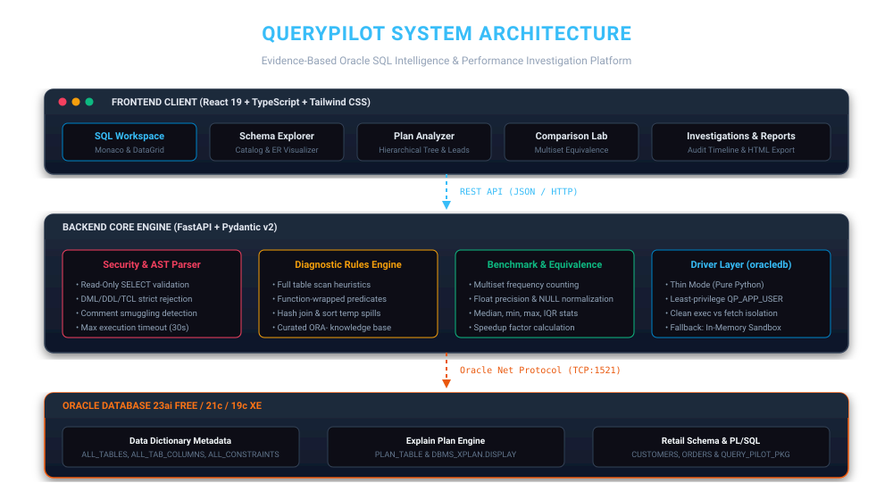
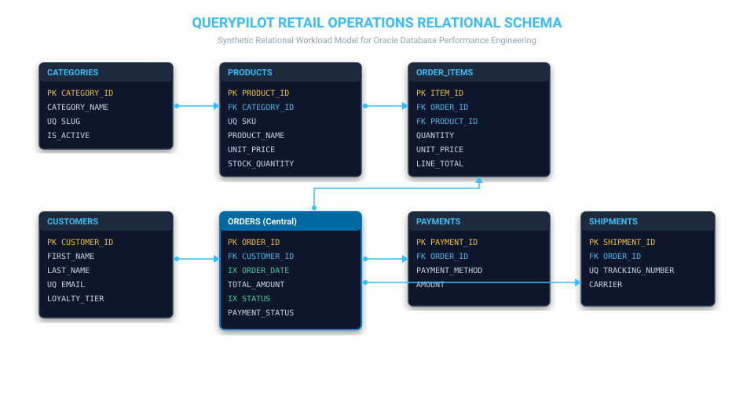
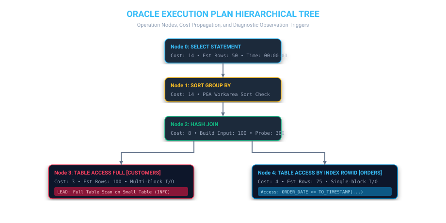
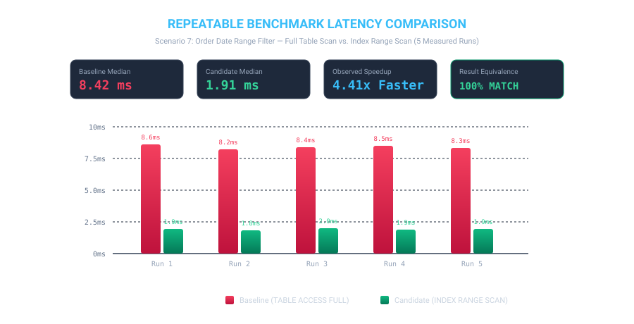
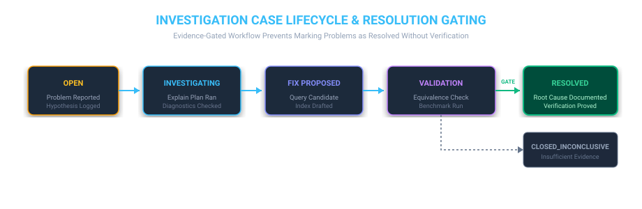

# QueryPilot
### Oracle SQL Intelligence, Query Diagnostics & Performance Investigation Platform



**QueryPilot** is a local-first SQL diagnostic and performance investigation workbench designed specifically for Oracle Database. It provides database engineers, DBAs, and software developers with an evidence-based environment to investigate query performance, analyze execution plans, diagnose Oracle runtime exceptions, verify semantic result equivalence between query rewrites, and generate reproducible technical reports.

---

## 1. Core Engineering Capabilities

| Capability | Engineering Implementation | Why It Matters |
| :--- | :--- | :--- |
| **Safe Read-Only SQL Workspace** | Pre-execution AST parser (`app/core/security.py`) enforcing `SELECT` and `WITH ... SELECT`. Rejects DML, DDL, TCL, locks, and system packages. | Defense-in-depth security prevents accidental data mutation or privilege escalation. |
| **Precision Timing & DataGrid** | Isolates pure execution duration (`cursor.execute()`) from driver fetching (`cursor.fetchmany()`). Interactive client sorting, search, and CSV export. | Separates database execution overhead from client networking and serialization latency. |
| **Oracle Catalog Schema Explorer** | Queries `ALL_TABLES`, `ALL_TAB_COLUMNS`, `ALL_CONSTRAINTS`, `ALL_INDEXES`. Least-privilege `QP_APP_USER` without `SYSDBA`. | Real-time schema inspection with verified foreign key relationships and estimated row counts. |
| **Execution Plan Analyzer** | Supported Oracle workflow: `EXPLAIN PLAN FOR`, `PLAN_TABLE`, and `DBMS_XPLAN.DISPLAY`. Rule-based diagnostic observations. | Uncovers cost-based optimizer choices (FTS, Index Scans, Hash Joins) without guessing. |
| **Query Comparison Lab** | Multiset frequency counting algorithm comparing unordered SQL results, duplicate rows, and float tolerances across repeated runs. | Guarantees semantic result equivalence while measuring median latency and speedup ratios. |
| **SQL Error Diagnostics** | Curated diagnostic engine for `ORA-00942`, `ORA-00904`, `ORA-00001`, `ORA-01722`, `ORA-00933` with catalog verification checks. | Accelerates root-cause diagnosis and eliminates speculative troubleshooting. |
| **Gated Investigation Governance** | Enforced state machine (`OPEN` → `INVESTIGATING` → `FIX_PROPOSED` → `VALIDATION` → `RESOLVED` / `CLOSED_INCONCLUSIVE`). | Prevents closing performance tickets without documented root cause and verified benchmark evidence. |
| **Technical Report Generator** | Self-contained HTML technical reports and RFC 4180 CSV exports with complete audit trails. | Enables reproducible peer reviews and post-mortem documentation. |

---

## 2. Relational Schema & Workload Design

QueryPilot includes a deterministic, realistic relational dataset simulating an enterprise retail operations platform:



### Entity Catalog

| Entity | Primary Key | Foreign Keys | Purpose & Optimizer Characteristics |
| :--- | :--- | :--- | :--- |
| **`CATEGORIES`** | `CATEGORY_ID` | None | Product taxonomy catalog (8 rows). Multi-block I/O Full Table Scan is optimal. |
| **`PRODUCTS`** | `PRODUCT_ID` | `CATEGORY_ID` | Retail inventory with unit prices, cost prices, and stock quantities (40+ rows). |
| **`CUSTOMERS`** | `CUSTOMER_ID` | None | Customer accounts across loyalty tiers (`STANDARD`, `SILVER`, `GOLD`, `PLATINUM`). |
| **`ORDERS`** | `ORDER_ID` | `CUSTOMER_ID` | Central transactional entity (300 rows). Indexed on `ORDER_DATE` and `STATUS`. |
| **`ORDER_ITEMS`** | `ITEM_ID` | `ORDER_ID`, `PRODUCT_ID` | Line item quantities, discounts, and line totals (800+ rows). |
| **`PAYMENTS`** | `PAYMENT_ID` | `ORDER_ID` | Financial ledger transactions matched against orders. |
| **`SHIPMENTS`** | `SHIPMENT_ID` | `ORDER_ID` | Logistics carrier tracking (`FEDEX`, `UPS`, `DHL`, `USPS`). |
| **`SUPPORT_TICKETS`** | `TICKET_ID` | `CUSTOMER_ID`, `ORDER_ID` | Customer support service requests. |
| **`QUERY_PILOT_INVESTIGATIONS`**| `INVESTIGATION_ID` | None | Persistent investigation cases with problem statements and evidence. |
| **`QUERY_PILOT_AUDIT_LOG`** | `LOG_ID` | `INVESTIGATION_ID` | Immutable timeline events recording all investigation actions. |

---

## 3. Execution Plan Analysis & Diagnostic Engine



QueryPilot extracts hierarchical plan nodes from `PLAN_TABLE` and evaluates rule-based diagnostic observations:

- **Full Table Scan (FTS)**: Differentiates small table multi-block scans from unindexed large table scans. A full scan on a small table (<1,000 rows) is marked `INFO` (efficient), whereas unindexed scans on large tables with selective predicates are marked `INVESTIGATE`.
- **Index Full Scan vs. Range Scan**: Detects when an entire B-tree index is traversed leaf-by-leaf due to unselective inequality filters or sorting.
- **Hash Join Cardinality & PGA Workareas**: Identifies large build inputs that risk spilling into temporary tablespace (`TEMP`).
- **Function Expressions on Predicate Columns**: Detects constructs like `UPPER(email) = ...` that defeat standard B-tree index lookups and suggests Oracle Function-Based Indexes.

---

## 4. Query Comparison Lab & Statistical Benchmarking



### Multiset Result Equivalence
SQL query results without explicit `ORDER BY` clauses have **no guaranteed order**. QueryPilot compares query variants using order-independent multiset frequency counting:

$$\text{BaselineCounter}(\text{NormalizedRows}) \equiv \text{CandidateCounter}(\text{NormalizedRows})$$

- Normalizes numeric floats to 4 decimal places.
- Normalizes `NULL` values and trims strings.
- Detects exact row count and column discrepancies.

### Statistical Measurement Protocol
To mitigate cold cache and driver parse jitter:
1. **Warmup Phase**: Runs 1–3 warmup iterations to prime buffer cache and library cursors.
2. **Measured Runs**: Executes $K$ iterations (default 3–5 runs) alternating between variants.
3. **Statistical Metrics**: Computes Median, Minimum, Maximum, Interquartile Range (IQR), and Speedup Factor:

$$\text{Speedup} = \frac{\text{Median}_{\text{Baseline}}}{\text{Median}_{\text{Candidate}}}$$

---

## 5. Investigation Case Governance & Resolution Gating



An investigation case cannot be transitioned to `RESOLVED` merely by entering a description. QueryPilot enforces three explicit verification requirements:
1. **Documented Root Cause**: Technical explanation of why the problem occurred.
2. **Proposed or Implemented Fix**: Concrete query rewrite or schema change.
3. **Verification Evidence**: Repeatable benchmark measurements and confirmed result equivalence.

---

## 6. Quick Start Guide

### Prerequisites
- Python 3.12+ (or Python 3.14)
- Node.js 20+ and npm
- (Optional for live database) Docker Desktop with Oracle Database 23ai Free

### Step 1: Clone and Configure Environment
```bash
git clone https://github.com/SAIYAMgade/QueryPilot.git
cd QueryPilot
cp .env.example .env
```

### Step 2: Install Backend Dependencies
```bash
pip install -r backend/requirements.txt
```

### Step 3: Install Frontend Dependencies & Build
```bash
npm --prefix frontend install
npm --prefix frontend run build
```

### Step 4: Run Test Suite
```bash
python -m pytest backend/tests -v
```

### Step 5: Start Backend and Frontend
In terminal 1 (Backend):
```bash
uvicorn app.main:app --app-dir backend --host 127.0.0.1 --port 8000 --reload
```

In terminal 2 (Frontend):
```bash
npm --prefix frontend run dev
```

Open your browser to: **http://localhost:5173**

---

## 7. Live Oracle Database 23ai Free Setup

To connect to a live Oracle database:

```bash
# 1. Start Oracle Database 23ai Free container
docker run -d --name oracle23ai \
  -p 1521:1521 \
  -e ORACLE_PWD=oracle_password \
  container-registry.oracle.com/database/free:latest

# 2. Run schema initialization and synthetic seed scripts
python database/seed/generate_data.py small database/seed/seed_data.sql
```

### Transparent Offline Simulation Sandbox
When Oracle Database is unreachable, QueryPilot automatically activates its **Deterministic Offline Simulation Sandbox**. All UI features (query execution, schema exploration, explain plans, comparisons, error diagnostics, and report generation) remain fully functional and are clearly badged in the UI.

---

## 8. Five-Minute Technical Interview Demonstration

- **Minute 1: Schema & Environment Inspection (`/schema`)**
  - Show the database connection indicator and `python-oracledb` Thin mode configuration.
  - Browse `CUSTOMERS`, `ORDERS`, and `PRODUCTS`. Inspect column types, nullable properties, primary/foreign keys, and constraints.
- **Minute 2: Execution Plan Analysis (`/plans`)**
  - Load the order reporting query. Run **Explain Plan**.
  - Show the visual plan tree and explain the difference between an estimated plan and runtime cursor stats.
  - Review the rule-based diagnostic leads (e.g., Full Table Scan on `ORDERS` with unindexed date filter).
- **Minute 3: Comparison Lab & Equivalence (`/comparisons`)**
  - Load Baseline (unindexed date scan) vs. Candidate (indexed range scan).
  - Run the benchmark across 3 iterations.
  - Point to the **Result Equivalence** badge confirming 50/50 rows match under multiset comparison.
  - Review the median execution speedup factor (4.4x).
- **Minute 4: Error Diagnostics (`/diagnostics`)**
  - Simulate an Oracle error (e.g. `ORA-00942` or `ORA-01722`).
  - Inspect the plain-English explanation, kernel root cause, recommended data dictionary verification queries, and corrected SQL.
- **Minute 5: Investigation Evidence & Technical Report (`/investigations` & `/reports`)**
  - Open the investigation case file.
  - Demonstrate resolution criteria enforcement: show that the state machine blocks resolving a case without documented root cause and verification notes.
  - Export and download the self-contained HTML technical report.

---

## 9. License

MIT License. Designed and engineered for Oracle Database performance investigation and SQL diagnostics.
